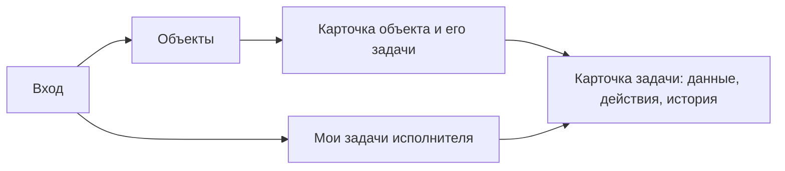

# Open source CRM: эталоны для 2CRM

Дата проверки: 7 ноября 2026 года.

## Вывод для проекта

Рекомендую продолжать 2CRM на React + TypeScript + Vite, Ant Design и Supabase. Использовать изученные проекты как источники решений, сохраняя небольшую собственную модель: объект, задача, пользователь с ролью и история смены статусов. Подходящего основания для замены стека или форка большой CRM исследование не дало.

Основной технический эталон — **Atomic CRM**, поскольку он использует React и Supabase и показывает, как связать SPA, Auth, SQL-схему и задачи. Для правил работы полезнее **OpenProject**: он явно различает статус, допустимый переход, роль и назначенного исполнителя. **Frappe CRM** полезен для организации экранов: общий список задач и те же задачи в контексте конкретной записи.

Это рекомендации по результатам анализа. Они не расширяют требования к функциям 2CRM. Воронка продаж, контакты клиентов, почта, отчётность и конструктор процессов в текущую реализацию не входят.

## Что проверено

Проведено 26 поисковых запросов по нескольким направлениям, затем проверены первичные данные 27 GitHub-репозиториев. У SuiteCRM отдельно рассмотрены репозитории двух поколений; это не два независимых продукта. NocoDB включён как соседний продукт с доступным кодом и иными условиями лицензирования, а не как безоговорочный open source кандидат.

Для каталога проверены описания, README, язык основного кода, архивность, текущий commit и сведения о лицензии. Для основных эталонов дополнительно прочитаны официальные документы о задачах, правах и архитектуре. Atomic CRM сохранён локально, подключён как source в SocratiCode и исследован по карте, поиску, символам, связям и точному чтению найденных файлов.

Проверка README и лицензии не равна аудиту всего продукта. Здесь нет утверждения, что все 27 приложений были установлены или испытаны. Коммерческие редакции и расширения не считаются функциями открытого ядра без отдельного подтверждения. Число звёзд не использовалось как доказательство безопасности или пригодности.

Commit, ветка и ссылки каждого репозитория сохранены в [repositories.json](repositories.json). Это снимки для исследования, а не выбор стабильной версии для развёртывания: например, README Monica отдельно различает развиваемую основную ветку и стабильную ветку 4.x.

## Карта рынка

### Самостоятельные CRM

| Проект | Лицензия проверенного репозитория | Устройство и полезный предмет изучения | Применимость к 2CRM |
| --- | --- | --- | --- |
| [Atomic CRM](https://github.com/marmelab/atomic-crm) | MIT | React, Supabase, задачи при контактах, отдельные SQL-схемы и миграции | Наиболее близок технически; правила доступа и модель статусов существенно отличаются |
| [Twenty](https://github.com/twentyhq/twenty) | Смешанная: AGPLv3, MIT-пакеты, коммерчески помеченные файлы | Объекты, представления и расширение CRM как платформы; React, NestJS, PostgreSQL, Redis | Изучать композицию карточек и списков; платформа и её инфраструктура здесь избыточны |
| [Frappe CRM](https://github.com/frappe/crm) | AGPL-3.0 | Frappe Framework и Vue; задачи в общем списке и внутри lead/deal | Хороший продуктовый эталон, но перенос приложения потребует смены стека |
| [Krayin](https://github.com/krayin/laravel-crm) | MIT | Laravel CRM, клиентский цикл, расширяемые бизнес-модули | Полезен для обзора обычных CRM-сущностей; продажи и Laravel не нужны нашему ядру |
| [Relaticle](https://github.com/relaticle/relaticle) | AGPL-3.0 | CRM с workspace-изоляцией, собственными полями и API | Показывает границу между простой CRM и платформой; workspace и AI-интеграции не добавляем |
| [BottleCRM](https://github.com/Django-CRM/Django-CRM) | MIT | Django REST Framework, SvelteKit, Flutter; продажи, поддержка, счета, задачи | Широкий клиентский цикл, существенно больше нашего процесса |
| [Django-CRM](https://github.com/DjangoCRM/django-crm) | AGPL-3.0 | Django Admin, отдельные приложения CRM, Tasks, Analytics и Mass Mail | Полезно разделение задач/проектов и продаж без обязательного смешивания доменов |
| [Fat Free CRM](https://github.com/fatfreecrm/fat_free_crm) | MIT, проверен `MIT-LICENSE` | CRM на Rails; обычные формы и связанные записи | Компактнее ERP, но не даёт преимуществ переноса на React + Supabase |

### Зрелые CRM и специализированные продукты

| Проект | Лицензия | Что изучать | Почему не основа реализации |
| --- | --- | --- | --- |
| [EspoCRM](https://github.com/espocrm/espocrm) | AGPL-3.0 | Раздельные права на чтение, изменение, назначение, удаление и ленту; уровни own/team/all | Нам нужны две фиксированные роли, не универсальная административная матрица |
| [SuiteCRM 7](https://github.com/SuiteCRM/SuiteCRM) и [SuiteCRM 8](https://github.com/SuiteCRM/SuiteCRM-Core) | AGPL-3.0 | Развитая CRM с большим числом модулей и двумя поколениями приложения | Большая предметная и технологическая поверхность для пяти экранов |
| [CiviCRM](https://github.com/civicrm/civicrm-core) | AGPL-3.0 | CRM для некоммерческих организаций и сообществ | Другая предметная область; не эталон строительного процесса приёмки |
| [Monica](https://github.com/monicahq/monica) | AGPL-3.0 | Персональные отношения, записи о взаимодействиях, задачи | Полезна как контрпример: история отношений не заменяет защищённую историю рабочих статусов |

### ERP с CRM и проектами

| Проект | Лицензия | Что видно в открытом продукте | Что берём в анализ |
| --- | --- | --- | --- |
| [Odoo Community](https://github.com/odoo/odoo) | LGPLv3 в корневой лицензии; отдельные компоненты могут отличаться | Набор связанных бизнес-приложений, включая CRM и проекты | Понимание связей объектов; не перенос ERP и её модулей |
| [ERPNext](https://github.com/frappe/erpnext) | GPL-3.0 | Проекты связывают задачи, трудозатраты и другие бизнес-операции | Идея «один объект собирает связанные работы»; учёт материалов и финансов вне ТЗ |
| [Dolibarr](https://github.com/Dolibarr/dolibarr) | GPL-3.0 | Модульные ERP/CRM, проекты и задачи | Сравнение ширины предметной модели; финансовые и складские сущности не требуются |
| [Axelor Open Suite](https://github.com/axelor/axelor-open-suite) | AGPLv3 по `LICENSE` | ERP/CRM на Axelor Open Platform, бизнес-модули и проекты | Платформенный подход не оправдан для фиксированного процесса |

### Конструкторы и соседние платформы

| Проект | Лицензия / граница | Предмет изучения | Вывод |
| --- | --- | --- | --- |
| [Corteza](https://github.com/cortezaproject/corteza) | Apache-2.0 | Конструирование приложений из записей, страниц и workflows | Показывает цену универсальности; собственный конструктор 2CRM не нужен |
| [Baserow](https://github.com/baserow/baserow) | MIT для открытой редакции; premium/enterprise имеют отдельные условия | Таблицы, связанные данные, представления и приложения | Табличный UI полезен как ориентир, но не заменяет наши правила доступа и переходов |
| [NocoDB](https://github.com/nocodb/nocodb) | Текущий `LICENSE.md`: Sustainable Use License | Продукт со spreadsheet-представлениями и доступным исходным кодом | Отдельная соседняя категория; не считать этот снимок эквивалентом MIT/Apache/GPL-проекта |

Лицензионные уточнения основаны на самих файлах: [Twenty](https://github.com/twentyhq/twenty/blob/9e02805028414026b7326ca56f738f64de9a7746/LICENSE), [Odoo](https://github.com/odoo/odoo/blob/6144a016c507b21613c0f35111b70c380f75879a/LICENSE), [Axelor](https://github.com/axelor/axelor-open-suite/blob/e7cbea53bae88d2540f59a70b09bf0f326f1022e/LICENSE), [Baserow](https://github.com/baserow/baserow/blob/313156b6ea6b98fbd740767aab767955f813b8ed/LICENSE), [NocoDB](https://github.com/nocodb/nocodb/blob/5f2e38194e0bda13d8818a412bd4d723fd944cb8/LICENSE.md). Отсутствие распознанного SPDX-ID в GitHub API само по себе не трактовалось как отсутствие лицензии.

### Управление работами и задачами

| Проект | Лицензия проверенного репозитория | Предмет изучения | Применимость |
| --- | --- | --- | --- |
| [OpenProject](https://github.com/opf/openproject) | GPL-3.0 | Workflow как разрешённые переходы с учётом роли, автора и исполнителя | Лучший из рассмотренных продуктовых эталонов для нашего цикла приёмки |
| [Redmine](https://github.com/redmine/redmine) | GPLv2 или более поздняя по `LICENSE.txt`; GitHub — зеркало официального SVN | Проекты, задачи, роли и workflow | Дополнительный ориентир процесса; не перенос Rails-приложения |
| [Plane](https://github.com/makeplane/plane) | AGPL-3.0 | Рабочие записи, проекты, представления и уровни участия | Полезно для иерархии экранов; спринты и workspace-администрирование не входят в ТЗ |
| [Leantime](https://github.com/Leantime/leantime) | AGPL-3.0 | Задачи, проекты, несколько представлений и проектные роли | Ориентир понятной повседневной работы; не основание добавлять календари и планирование |
| [Vikunja](https://github.com/go-vikunja/vikunja) | AGPL-3.0 | Task-first продукт: проекты, задачи, назначение и несколько представлений | Полезен простой список задач; совместный доступ к проекту не равен доступу только к назначенным задачам |
| [Taiga backend](https://github.com/taigaio/taiga-back) | MPL-2.0 | Backend системы управления командной работой | Сравнение проектной модели, но agile-процессы нам не нужны |
| [Huly](https://github.com/hcengineering/platform) | EPL-2.0 | Платформа с приложениями для проектов, CRM, общения и других процессов | Пример объединённого рабочего пространства; слишком широкий фундамент для этого ТЗ |

Сведения о возможностях в таблицах взяты из README соответствующих репозиториев и указанных ниже официальных документов. Они не доказывают одинаковые возможности облачной и открытой редакций.

## Подробный разбор основных эталонов

### 1. Atomic CRM: близкий стек, другая модель доступа

Исследованный commit: `98bb47ac3ddb2115dfe363dec48d5dc27dee3481`, лицензия MIT. Локальная копия хранится в `.cache/sources/atomic-crm` и подключена к проекту через SocratiCode. Индекс ограничен полезным кодом: 409 файлов, 1449 фрагментов; общие UI-примитивы, документационный сайт, зависимости и сборки исключены. Это намеренно ограниченная карта, не полный граф всех зависимостей.

По [описанию архитектуры](https://marmelab.com/atomic-crm/doc/developers/architecture-choices/), приложение — SPA с Supabase в качестве backend. Профиль хранится отдельно от `auth.users`; представления агрегируют связанные данные, специальные операции вынесены в Edge Functions. В приложении есть собственный слой admin-компонентов и провайдеров данных. Переносить весь этот слой ради пяти экранов нецелесообразно.

Проверенные участки исходников:

| Участок | Наблюдение по коду | Следствие для 2CRM |
| --- | --- | --- |
| [Таблица задач, `01_tables.sql`, строки 113–123](https://github.com/marmelab/atomic-crm/blob/98bb47ac3ddb2115dfe363dec48d5dc27dee3481/supabase/schemas/01_tables.sql#L113-L123) | Задача связана с контактом; выполнение представлено `done_date`, назначение — `sales_id` | Наша задача связана с объектом и имеет пять статусов; замена названий полей не создаст нужный процесс |
| [Политики задач, `05_policies.sql`, строки 58–62](https://github.com/marmelab/atomic-crm/blob/98bb47ac3ddb2115dfe363dec48d5dc27dee3481/supabase/schemas/05_policies.sql#L58-L62) | Политики SELECT/INSERT/UPDATE/DELETE допускают авторизованных пользователей через `true` | Это модель общего рабочего пространства. Она не обеспечивает наш запрет чтения чужих задач исполнителем |
| [Переключение выполнения, `Task.tsx`, строки 66–73](https://github.com/marmelab/atomic-crm/blob/98bb47ac3ddb2115dfe363dec48d5dc27dee3481/src/components/atomic-crm/tasks/Task.tsx#L66-L73) | Клиент переключает дату выполнения между `null` и текущим временем | В 2CRM нужны именованные действия и серверная проверка конкретного перехода, а не checkbox «готово» |
| [Задачи внутри контакта](https://github.com/marmelab/atomic-crm/blob/98bb47ac3ddb2115dfe363dec48d5dc27dee3481/src/components/atomic-crm/contacts/ContactTasksList.tsx#L10-L46) | Тот же список задач получает фильтр родительской записи; есть загрузка и пустое состояние с действием создания | Можно использовать один компонент списка для объекта и «Моих задач», сохранив разные разрешения на действия |
| [Лента активности](https://github.com/marmelab/atomic-crm/blob/98bb47ac3ddb2115dfe363dec48d5dc27dee3481/supabase/migrations/20260314120000_activity_log_view.sql#L1-L80) | `activity_log` — представление, объединяющее события создания компаний, контактов, сделок и заметок | Такая лента не заменяет отдельную неизменяемую историю наших переходов |
| [Представления](https://github.com/marmelab/atomic-crm/blob/98bb47ac3ddb2115dfe363dec48d5dc27dee3481/supabase/schemas/03_views.sql#L102-L134) | Агрегирующее представление контактов использует `security_invoker` | Если в 2CRM позже появятся summary-представления, их поведение нужно проверять под ролями, а не только под владельцем базы |

Отдельно полезен механизм состояний мутации: checkbox недоступен, пока запрос выполняется. Нам нужен такой же запрет повторной отправки, но визуальное завершение критичного действия должно подтверждаться ответом базы.

Общее разрешение авторизованным пользователям в этом эталоне не объявляется уязвимостью Atomic CRM: у продукта другой договор доступа. Вывод касается несоответствия нашему ТЗ, а не оценки чужой установленной системы.

Документация [Data Providers](https://marmelab.com/atomic-crm/doc/developers/data-providers/) объясняет, что публичное демо использует FakeRest. Оно подходит для просмотра UI, но не доказывает работу Supabase Auth и RLS. В 2CRM демонстрационный режим с подменой backend не нужен: сдаём реальные учётные записи и сохранение данных в Supabase.

[Управление пользователями](https://marmelab.com/atomic-crm/doc/users/user-management/) в Atomic также отличается: первый пользователь становится администратором, затем добавление пользователей ограничивается специальным процессом приложения. Не переносим этот bootstrap и приглашения: по нашему ТЗ учётные записи допустимо создавать вручную штатными средствами Supabase.

### 2. OpenProject: эталон разрешённых действий

В официальном [описании workflows](https://www.openproject.org/docs/system-admin-guide/manage-work-packages/work-package-types/workflows/) переходы задаются для роли и типа работы, отдельно учитываются автор и исполнитель. Матрица явно различает исходный и целевой статус.

Для 2CRM полезен сам принцип: доступное действие зависит от состояния задачи и отношения пользователя к ней. Нам не нужны редактор матрицы, настраиваемые типы работ, произвольные статусы или копирование workflows. Достаточно фиксированных правил из ТЗ в базе и соответствующих кнопок.

Переназначение — изменение ответственного. Если статус остаётся прежним, это не переход статуса. Поэтому оно не должно создавать фиктивное событие перехода. Доступ прежнего и нового исполнителей пересчитывается по назначению.

### 3. Frappe CRM: одна задача в двух контекстах

Документ [Task](https://docs.frappe.io/crm/task) показывает отдельный список задач и вкладку задач внутри lead/deal. Задача имеет собственные поля и назначение; родительская карточка даёт контекст. В [описании участников](https://docs.frappe.io/crm/inviting-your-team) различаются обычный пользователь, менеджер и администратор.

Для нас полезна связь «карточка объекта → его задачи → карточка задачи» и отдельный рабочий список исполнителя. Дополнительная роль администратора в самом интерфейсе не нужна: ТЗ предусматривает две роли, а создание учётных записей выполняется вне пользовательского процесса. Приоритеты, напоминания и сроки задач из Frappe не добавляем.

### 4. EspoCRM: чтение, назначение и изменение — разные права

В [документации ролей](https://docs.espocrm.com/administration/roles-management/) отдельно перечислены действия и уровни доступа. Разрешение на назначение не тождественно разрешению на изменение записи. Это помогает избежать ошибки «раз пользователь может изменить статус своей задачи, значит он может изменить все её поля».

В 2CRM исполнитель меняет только разрешённый статус своей задачи. Он не получает право на переназначение, редактирование автора или роли, изменение описания и удаление. Постановщик имеет отдельные права на эти операции.

Найденное [описание Projects](https://docs.espocrm.com/extensions/project-management/projects/) относится к расширению Project Management. Его нельзя выдавать за подтверждение наличия всех этих возможностей в базовом открытом ядре EspoCRM. В частности, описанный там доступ к общей ленте проекта может отличаться от нашей строгой изоляции чужих задач. Идею разделения прав изучаем, модель доступа не копируем.

### 5. Twenty: устройство платформы не является необходимостью

В [README Twenty](https://github.com/twentyhq/twenty/blob/9e02805028414026b7326ca56f738f64de9a7746/README.md) CRM описана как набор расширяемых объектов, представлений и workflows. Стек включает React, NestJS, PostgreSQL, Redis и другие компоненты.

Это полезный ориентир композиции рабочих записей. Но собственные метаданные объектов, workspace-платформа и инфраструктура фоновых процессов не следуют из нашего ТЗ. При фиксированных двух сущностях и одном процессе такая основа увеличит стоимость понимания, изменения и проверки.

### 6. Django-CRM: задачи можно отделить от продаж

В [руководстве установки](https://github.com/DjangoCRM/django-crm/blob/4118388782d50d994787937f966d79e27d316091/docs/installation_and_configuration_guide.md) приложения Tasks, CRM, Analytics и Mass Mail описаны отдельно; Tasks не требует настройки CRM-модуля продаж.

Для 2CRM это поддерживает границу предметной области: слово CRM не обязывает вводить лиды и сделки. Наш полезный продукт организует работы по объектам. Разделяем код по объектам, задачам и входу, а не воспроизводим чужой набор приложений.

### 7. Vikunja и Leantime: начать с рабочего списка

[Vikunja Help](https://vikunja.io/help/) предлагает несколько представлений задач и рекомендует начинать со списка. [Описание задач Leantime](https://support.leantime.io/en/article/mastering-leantimes-task-management-feature-nbwe18/) показывает, как более широкий продукт добавляет этапы, типы, даты и планирование.

Для нашего объёма достаточно таблицы или списка с названием, объектом, исполнителем и статусом. Не нужны одновременно Kanban, Gantt и календарь. Совместный доступ к проекту в других продуктах не следует переносить на 2CRM, где исполнитель не должен получать весь проектный набор задач.

### 8. ERPNext: объект как контекст работ

В [примере проектного модуля](https://docs.frappe.io/erpnext/projects/introduction/getting-started) производственный проект объединяет несколько работ. Вместе с этим ERPNext связывает проект с другими бизнес-операциями.

Для 2CRM полезна только первая связь: объект собирает задачи. Материалы, закупки, счета и трудозатраты остаются за рамками текущего продукта.

## Рекомендуемый минимальный продукт

### Навигация и повседневный сценарий

Постановщик создаёт объект, затем задачу и назначает исполнителя. Исполнитель открывает её из своего списка, берёт в работу и отправляет на проверку. Постановщик принимает результат либо возвращает с объяснением. После возврата исполнитель снова берёт задачу в работу. На карточке понятно, кто должен действовать следующим.

Набор экранов уже определён ТЗ. Дополнительные главная панель, отчёты и интерфейс управления пользователями для этого сценария не требуются.

### Что делает приложение пригодным для людей

Это критерии реализации уже заданных функций, не новые модули:

- Настоящий вход под выданной учётной записью и восстановление сессии при перезагрузке.
- Данные сохраняются в Supabase и доступны после повторного входа; браузерный mock не подменяет backend.
- В списке видны понятные названия объектов и статусов; ссылка на карточку работает после обновления страницы.
- Пустой список отличается от загрузки и от ошибки запроса. В разрешённом контексте есть понятное действие создания.
- При выполнении запроса повторная отправка недоступна. Ошибка не маскируется успешным изменением интерфейса.
- Возврат на доработку показывает обязательный комментарий, а исполнитель видит его в истории.
- После переназначения прежний исполнитель не сохраняет доступ через прямую ссылку или API. Новый исполнитель видит задачу в прежнем статусе.
- Обычные формы и карточки остаются читаемыми при узком окне; отдельный мобильный клиент не требуется.

### Границы данных и безопасности

1. `profiles`, `objects`, `tasks`, `task_status_history` достаточны для текущих сущностей. Это наша рекомендуемая схема, а не копия модели любого эталона.
2. RLS ограничивает строки, доступные роли. Разрешение видеть объект не открывает все его задачи.
3. Право исполнителя на переход не разрешает ему менять остальные поля задачи. Проверка не ограничивается UI.
4. Создание истории и смена статуса выполняются атомарно в базе; пользователь и время берутся из доверенного серверного контекста.
5. История хранится отдельно от изменяемого текущего состояния. Агрегированная activity-view не выполняет это требование сама по себе.
6. Удаление задачи и объекта реализуется без физического удаления истории. Предложенное логическое удаление остаётся допущением реализации, которое нужно честно описать при сдаче.
7. Обновление статуса и переназначение используют актуальное состояние строки в транзакции, чтобы конфликтующие запросы не создали ложную историю.
8. В клиенте используются URL Supabase и publishable key. Секретный ключ не является способом исправить отказ RLS.

Подробная предварительная схема остаётся в [ARCHITECTURE.md](../ARCHITECTURE.md). Исследование не потребовало менять стек или увеличивать число пользовательских ролей.

## Что намеренно не переносим из эталонов

| Возможность чужого продукта | Причина оставить за рамками 2CRM |
| --- | --- |
| Лиды, сделки, контакты, воронки | В ТЗ есть объекты и задачи, нет процесса продаж |
| Настраиваемые поля и конструктор workflows | Поля и переходы уже фиксированы |
| Несколько организаций и workspace-иерархия | Изоляция пользователей нужна, multi-tenant продукт не задан |
| Почта, телефония, мессенджеры, AI/MCP внутри CRM | Не участвуют в заданном цикле работы |
| Gantt, спринты, зависимости, календарь | Не нужны для выполнения и приёмки назначенной задачи |
| Уведомления, дедлайны, приоритеты | Дополнительные сущности и правила вне перечисленных полей |
| CRM-фреймворк или второй UI-kit целиком | Потребуют освоения и сопровождения ради уже доступных форм и таблиц Ant Design |
| Система приглашений и редактирования пользователей | ТЗ допускает ручное создание учётных записей в Supabase |
| FakeRest как сдаваемый backend | Не проверяет реальные учётные записи, сохранение данных и защиту базы |

## Что проверять при реализации

Начать с небольшого вертикального API-сценария: исполнитель читает свою задачу, но не чужую, затем проверить то же по прямому ID. Далее по одному добавлять допустимые переходы, запрет изменения остальных полей, обязательный комментарий, защищённую историю, переназначение и удаление без потери истории. Для проверяемого поведения применять TDD.

Особенно важны проверки, которые нельзя заменить красивым UI:

- Запрос без сессии не получает данные.
- Второй исполнитель не читает чужие задачи, включая вложенный список в доступном ему объекте.
- Прямой UPDATE или RPC не позволяют перескочить статус, подменить автора либо назначение.
- Повторный конфликтующий запрос не записывает второй переход из устаревшего состояния.
- Историю нельзя вставить, изменить или удалить через обычный API.
- После перезагрузки и повторного входа сохраняется действительное состояние задачи.

Эти проверки пока являются планом. Анализ чужого кода не заменяет испытание нашей базы и наших учётных записей.

## Сохранённый source и точка продолжения

Atomic CRM подключён к локальному проекту как отдельный источник SocratiCode. Его код не добавлен в исходники 2CRM и не опубликован заново в этом репозитории. Для повторного исследования использовать сохранённый commit и существующий индекс, а не скачивать новую основную ветку молча.

Полезные точки входа для продолжения:

- `supabase/schemas/01_tables.sql` — сущности и связи.
- `supabase/schemas/05_policies.sql` — фактический договор доступа.
- `src/components/atomic-crm/tasks/Task.tsx` — мутация выполнения и состояние запроса.
- `src/components/atomic-crm/contacts/ContactTasksList.tsx` — задачи в контексте родительской записи.
- `supabase/migrations/20260314120000_activity_log_view.sql` — отличие агрегированной ленты от истории переходов.

Зависимости Atomic CRM не устанавливались, его скрипты не запускались, развёртывание не выполнялось. Выводы по нему основаны на документации и статическом чтении конкретного снимка. Следующий рекомендуемый этап — реализация собственного минимального цикла и проверок из ТЗ; расширение функциональности сейчас не требуется.

## Журнал направлений поиска

Поиск шёл от общей карты к конкретным функциям и затем к первичным источникам. Выполнены следующие 26 запросов; результаты каталогов и сравнений использовались для обнаружения кандидатов, технические выводы проверялись по самим проектам.

1. `open source CRM React Supabase Atomic CRM task contacts roles GitHub`
2. `open source CRM market Twenty Frappe EspoCRM SuiteCRM comparison GitHub licenses`
3. `open source construction project task approval workflow OpenProject Leantime Vikunja`
4. `site.github.com open source CRM Krayin Corteza Axelor Dolibarr`
5. `site.github.com CRM Supabase React role based access task management`
6. `site.openproject.org docs workflows role status transitions tasks permissions`
7. `Atomic CRM marmelab architecture Supabase tasks permissions`
8. `Twenty CRM architecture tasks permissions objects open source`
9. `Frappe CRM tasks role permissions documentation`
10. `EspoCRM roles own team all task stream`
11. `OpenProject workflows assignee author status transitions documentation`
12. `Vikunja permissions task assignees activity history open source`
13. `Leantime open source task status roles projects`
14. `Plane open source issue activity permissions roles architecture`
15. `site.github.com/marmelab/atomic-crm tasks RLS MIT`
16. `site.github.com/twentyhq/twenty license architecture`
17. `site.github.com/frappe/crm AGPL`
18. `site.github.com/krayin/laravel-crm license`
19. `site.github.com/cortezaproject/corteza low code CRM Apache`
20. `site.github.com/axelor/axelor-open-suite CRM`
21. `site.github.com/Dolibarr/dolibarr ERP CRM`
22. `site.github.com/monicahq/monica personal CRM`
23. `open source CRM lightweight Rails Fat Free CRM Django BottleCRM`
24. `NocoDB license sustainable use Baserow core MIT license`
25. `open source CRM construction ERPNext project tasks workflow`
26. `open source CRM project status history roles Redmine workflow`
